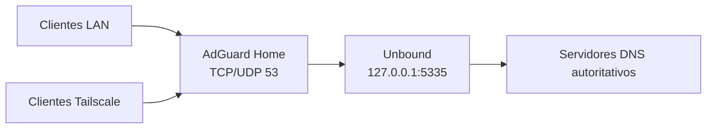

# Raspberry Pi Zero 2 W

Documentación del servidor DNS y acceso remoto instalado en un Raspberry Pi Zero 2 W.

Estado verificado: 13 de agosto de 2026.

## Servicios

| Servicio | Versión | Función | Estado |
|---|---:|---|---|
| AdGuard Home | 0.107.73 | Filtrado DNS para la red local | Activo y habilitado |
| Unbound | 1.22.0 | Resolución recursiva y validación DNSSEC | Activo y habilitado |
| Tailscale | 1.98.9 | Acceso remoto privado | Activo, autorizado y habilitado |
| OpenSSH | Debian 13 | Administración | Activo |

## Flujo DNS



AdGuard Home filtra las consultas. Unbound resuelve desde la raíz de DNS, guarda respuestas en caché y valida DNSSEC.

## Direcciones administrativas

| Interfaz | Dirección |
|---|---|
| LAN Wi-Fi | `192.168.1.81/24` |
| Gateway | `192.168.1.254` |
| Tailscale IPv4 | `100.82.214.23/32` |

El panel de AdGuard usa el puerto `80`. SSH usa el puerto `22`. Unbound solo escucha en loopback.

## Documentos

- [Mapa del sistema](docs/system-map.md)
- [Operación y rollback](docs/operations.md)
- [Recuperación de contraseña](docs/password-recovery.md)

## Recuperación automatizada

El lanzador de Windows prepara la microSD y retira el acceso temporal al terminar:

```powershell
.\scripts\Recover-RaspberryPi.cmd prepare
.\scripts\Recover-RaspberryPi.cmd finish
```

Consulta la [guía de recuperación](docs/password-recovery.md) antes de usarlo. El Pi recibe la clave pública; la clave privada permanece en `C:\Users\x-Rau\.ssh`.

## Configuraciones públicas

- [Unbound para AdGuard Home](configs/unbound/adguard-home.conf)
- [Orden de arranque de AdGuard](configs/systemd/AdGuardHome.service.d/unbound.conf)

Los archivos de provisión, claves, contraseñas y respaldos no pertenecen a este repositorio. `.gitignore` bloquea sus nombres comunes.

## Acceso administrativo

La cuenta `raul` usa una clave Ed25519 y conserva una contraseña para consola y sudo. SSH prefiere la clave y puede entrar sin mostrar un prompt de contraseña.
