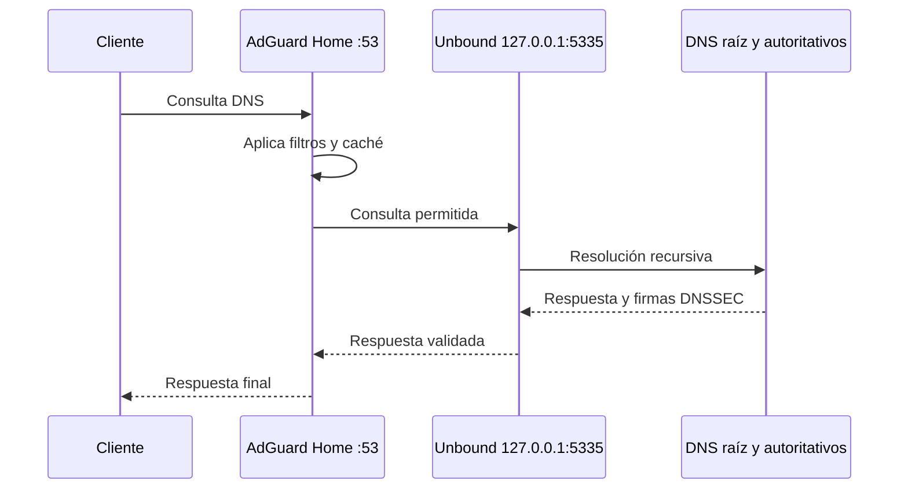

# Mapa del sistema

## Hardware y sistema operativo

| Campo | Valor |
|---|---|
| Equipo | Raspberry Pi Zero 2 W Rev 1.0 |
| Arquitectura | ARM64 (`aarch64`) |
| CPU | 4 núcleos |
| RAM utilizable | 416 MiB |
| Swap | 415 MiB |
| Almacenamiento raíz | 29 GiB, 12 % usado |
| Sistema | Debian GNU/Linux 13 `trixie` |
| Kernel | `6.12.47+rpt-rpi-v8` |
| Zona horaria | `America/Mexico_City` |

## Red

```text
Internet
   |
Router 192.168.1.254
   |
Wi-Fi 192.168.1.0/24
   |
Raspberry Pi 192.168.1.1
   |
tailscale0 100.82.214.23/32
```

El Pi tiene IPv6 global. Este repositorio omite esa dirección. El firewall IPv6 del router debe bloquear conexiones entrantes no solicitadas.

El Pi usa la IP estática `192.168.1.1/24` (método `manual` en NetworkManager). Hasta agosto de 2026 usaba `192.168.1.81`. `raspberrypi.local` (mDNS) siempre resuelve a la dirección actual.

## Cadena DNS



### AdGuard Home

- Binario: `/opt/AdGuardHome/AdGuardHome`
- Configuración privada: `/opt/AdGuardHome/AdGuardHome.yaml`
- Unidad: `/etc/systemd/system/AdGuardHome.service`
- DNS: TCP y UDP `53` en todas las interfaces
- Panel: TCP `80` en todas las interfaces
- Upstream: `127.0.0.1:5335`
- Protección: habilitada
- Caché: 4 MiB

La configuración privada contiene datos que no deben entrar en Git.

### Unbound

- Paquete: `unbound 1.22.0-2+deb13u3`
- Configuración local: `/etc/unbound/unbound.conf.d/adguard-home.conf`
- Listener: TCP y UDP `127.0.0.1:5335`
- Hilos: 1
- Caché de mensajes: 8 MiB
- Caché RRset: 16 MiB
- Trust anchor: `/var/lib/unbound/root.key`
- Root hints: `/usr/share/dns/root.hints`
- DNSSEC: habilitado
- QNAME minimisation: habilitado

AdGuard declara una dependencia systemd sobre Unbound en `/etc/systemd/system/AdGuardHome.service.d/unbound.conf`.

## Tailscale

| Ajuste | Valor |
|---|---|
| Estado | `Running`, nodo online |
| IPv4 | `100.82.214.23` |
| Aceptar DNS del tailnet | No |
| Aceptar rutas | No |
| Tailscale SSH | No |
| Rutas anunciadas | Ninguna |
| Serve | Sin configurar |
| Funnel | Sin configurar |

`tailscaled` escucha UDP `41641` para WireGuard. La conexión reportó UDP disponible, IPv4 e IPv6 funcionales y DERP más cercano en Dallas.

La computadora usada durante la instalación no tenía cliente Tailscale. Falta comprobar SSH, DNS y el panel desde un segundo peer del tailnet.

## Puertos

| Puerto | Protocolo | Proceso | Alcance |
|---:|---|---|---|
| 22 | TCP | OpenSSH | LAN, IPv6 y Tailscale según firewall |
| 53 | TCP/UDP | AdGuard Home | LAN, IPv6 y Tailscale según firewall |
| 80 | TCP | AdGuard Home | LAN, IPv6 y Tailscale según firewall |
| 5335 | TCP/UDP | Unbound | Solo `127.0.0.1` |
| 41641 | UDP | tailscaled | Transporte Tailscale |
| 5353 | UDP | Avahi | Descubrimiento local |

No existían reglas nftables visibles antes de instalar Tailscale. Tailscale administra sus propias reglas.

## Recursos después de la instalación

| Recurso | Lectura |
|---|---:|
| RAM usada | 260 MiB |
| RAM disponible | 155 MiB |
| Swap usada | 77 MiB |
| AdGuard Home RSS | ~100 MiB |
| tailscaled RSS | ~37 MiB |
| Unbound RSS | ~5 MiB |

El equipo no tiene margen para Uptime Kuma, Grafana, Prometheus o Netdata. Coloca esas aplicaciones en otro host.

## Riesgos conocidos

1. AdGuard Home y SSH escuchan sobre IPv6 global. Revisa el firewall del router.
2. El Pi es el único DNS local. Una falla de energía, Wi-Fi o microSD deja la red sin filtrado.
3. `/opt/AdGuardHome` tenía permisos `0777`; AdGuard recomienda `0700`. Revisa propiedad y contenido antes de corregirlo.
4. Las actualizaciones son automáticas (`unattended-upgrades`) y pueden reiniciar el Pi a las 04:30. Ver [operación](operations.md#actualizaciones).
5. Cloud-init marca estado degradado por el módulo ausente `cc_netplan_nm_patch`; no registró errores y la red funciona.

## Respaldo previo

El respaldo root-only se encuentra en:

```text
/var/backups/rgzz-pi-20260725-pre-tailscale-unbound
```

Contiene configuración de AdGuard, SSH, NetworkManager, arranque, inventario de paquetes, puertos y hashes SHA-256. El directorio usa permisos `0700`.
